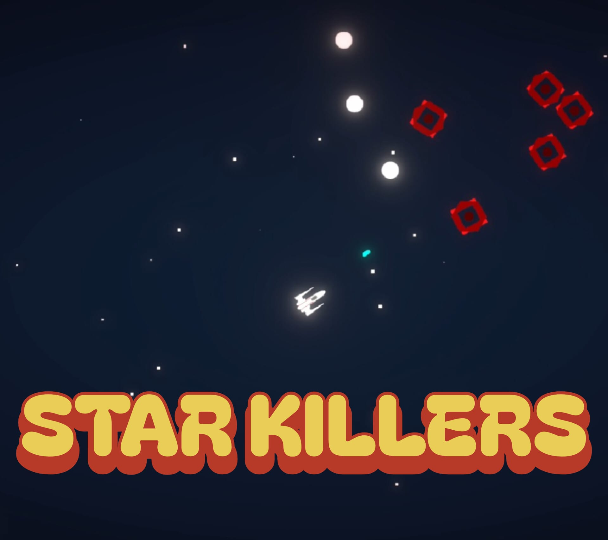
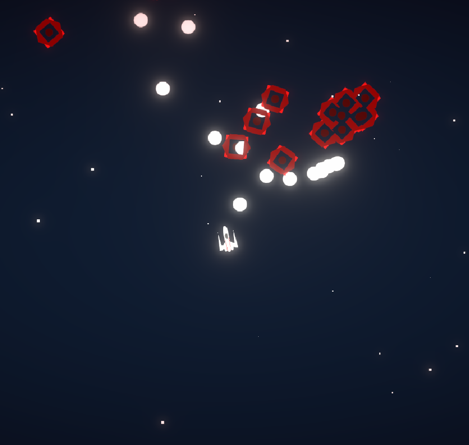

# Toy Soldier Down
Shoot your way out of the room and into your space ship. Solve custom puzzles and trigger multiple cutscenes until you reach the final boss, Robot Brad.

<video src="{{ '/assets/videos/ToySoldierDownDemo.mp4' | relative_url }}" width="100%" height="100%" controls></video>
# Star Killers
Blast off into space in this arcade shooter. Programmed with Unity, unique enemy mechanics are made to destroy your starship. 
Developed a game from scratch and learned the fundamentals of classes such as player, weapons, and enemies.

First, I developed a self-destructing enemy that explodes upon contact with your starship. I then designed a second enemy that shoots from a specific distance, which became the most challenging but rewarding mechanic to implement. 

Independently researched and implemented what I learned to create the diverse enemy types. Designed a space-survival game where the objective is to beat your highscore and survive as long as possible.
  

